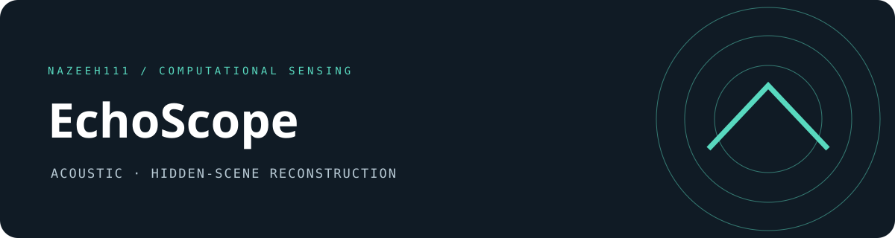

# EchoScope



Reconstruct hidden scenes from frequency-swept acoustic measurements. The workflow includes microphone calibration, demodulation, initial volume reconstruction, point-spread-function fitting, and iterative refinement.

## Inspect the command path without captures

```sh
python3 -m unittest discover -s tests -v
```

These four standard-library checks exercise the actual scene dispatcher with its expensive reconstruction worker replaced. They verify scene selection and order without installing the legacy numerical stack or loading measurements. They do not reconstruct a hidden scene.

For local runs, the optional confocal-save tests need NumPy and explicitly skip without it. They use tiny synthetic arrays with plotting and LCT replaced. In CI, the existing dispatcher job is retained and a separate Python 3.12 / NumPy 2.5.4 job requires all three confocal-save methods to pass without skips or expected failures. These tests verify saved arrays and save gating, not scene reconstruction.

## Reconstruct an external capture

Run from the repository root, using the original environment versions in `requirements.txt`. These are legacy pins; a current Python installation may not accept them. The numerical pipeline and plotting defaults are retained. This is an archived research workflow, not a packaged sensing app.

Download the [measurement dataset](https://drive.google.com/a/stanford.edu/file/d/1pnRiD3e4EQiu-akvHkCMOyghwbVtQuvt/view?usp=sharing) separately and place its scene `.pkl` captures in `data/`. Dataset availability has not been verified. Calibration tables alone are not enough to reconstruct a scene.

Follow the dependency order below. The point-spread function (PSF) describes the spatial blur used by iterative refinement:

```sh
# Initial scene volume and calibration-target volume:
python3 AcousticNLOSReconstruction.py letter_H
python3 AcousticNLOSReconstruction.py psf
# Fit the calibration-target PSF before refining a scene:
python3 FitGaussianPSF.py
# The inherited iterative writer uses this separate destination:
mkdir -p chimera/raw
python3 ADMMReconstruction.py letter_H
```

### Follow the files

1. **Capture → calibrated frequency data:** `data/letter_H.pkl` becomes `data/letter_H.npy`. An available `letter_H_bg.pkl` is demodulated separately for background subtraction. Existing demodulated arrays are reused unless the source's `overwrite_raw` option is changed.
2. **Initial reconstruction:** the default plotting path writes `data/letter_H.png` and `data/letter_H_out.npy`. The latter holds the volume and metadata consumed by iterative refinement. Turning off `enable_plotting` also disables this save in the retained implementation.
3. **PSF fit:** `FitGaussianPSF.py` reads `data/psf_out.npy`, opens its fit plots, then writes `data/psf_gaussian.npy` and `data/psf_gaussian_params.npy`.
4. **Iterative result:** on convergence, `ADMMReconstruction.py` writes `chimera/raw/letter_H_admm_out.npy`. That inherited output directory must exist. Use a working copy of prior results: plotting, fitting and final-save paths can replace files with the same names.

Initial reconstruction supports `double`, `letter_H`, `corner_reflectors`, `psf`, `resolution_corner1m`, `resolution_corner2m`, `resolution_plane1m`, `resolution_plane2m` and `letters_LT`. The `all` selector dispatches them in that order. Iterative refinement supports only `double`, `letter_H`, `corner_reflectors` and `letters_LT`.

The defaults use a 48 kHz sample rate, 2–20 kHz chirp and 16 transmit/receive channels. Raw captures and a reconstructed-scene volume are not bundled. No microphone, speaker or hardware acquisition command is provided by this workflow.

## Verification

See [verification](VERIFICATION.md) for exact local checks and limits. Small synthetic kernels establish numerical consistency, not captured-scene replication. `util/lct.py` includes an unused standalone `lct` helper with an inherited argument mismatch; the main reconstruction uses `run_lct` instead.

## License

The reconstruction source uses the [MIT license](LICENSE); new documentation and presentation use [MIT](LICENSE-BRANDING). Separate bundled component notices remain in [THIRD_PARTY_NOTICES.md](THIRD_PARTY_NOTICES.md). [Source details](NOTICE.md).
